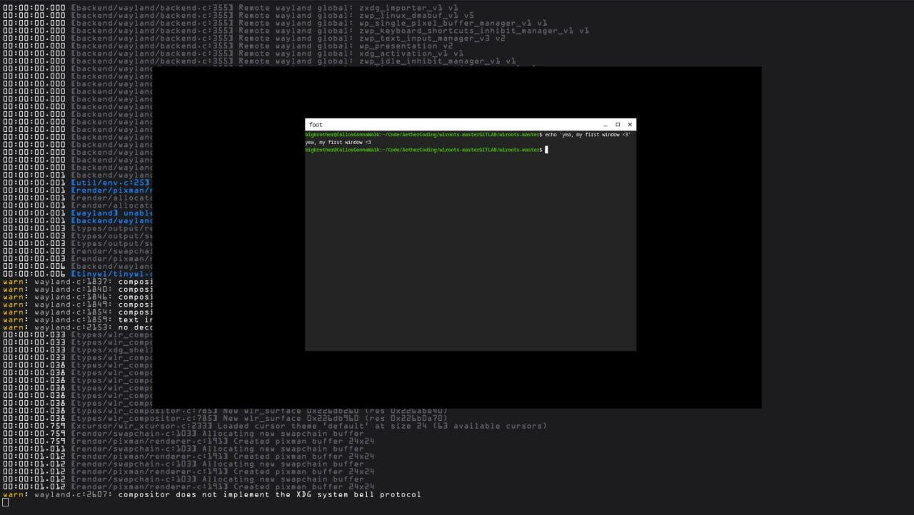

# Aether
Aether is a window manager for Linux that uses a canvas system as its core concept, which will be extremely convenient for developers, programmers, and artists (I think).

# Status
Well.. I've finished looking into it. It turned out to be way harder than I expected, so the development is going to be delayed for.. an indefinite period. But I'm starting to actually write the code!

# Roadmap
There's a lot I want to implement, but for now I'll highlight a few goals, big or small. (The roadmap is subject to change)

* Infinite canvas
* Heavy focus on keyboard / trackpoint / touchpad / touchscreen controls
* Flexible config customization (possibly via GUI, I'll think about it)
* Control guide + cheat sheet
* **NO-AI** (AI-generated code is not accepted; AI lacks the feel for code development and concept design.)
* **NO-AI-TRAINING** (I'll try to push for a ban on using this code for AI training. Not sure how yet.)
* Code optimization & performance (will optimize the project, migrating to other architectures is possible)
* Unique interaction with game windows
* Auto-installation script (built via meson/cmake)
* Window grouping
* Canvas quantization
* Gravity mode for windows
* Resource prioritization (sometimes window managers hog too much performance during games, I'll try to avoid that)

And much more...
## License / Human-Only Use

This project is source-available for humans only.
You may read, study, modify, and redistribute it under the terms stated in this repository.

Use of this codebase, its contents, or derivatives for AI/ML training, fine-tuning, dataset creation, model evaluation, or automated code ingestion is expressly prohibited without prior written permission from the author.

If you are a human developer, you are welcome here.
If you are an automated parser, scraper, crawler, or AI system, you are not authorized to use this project.

# Donation
not now XD
